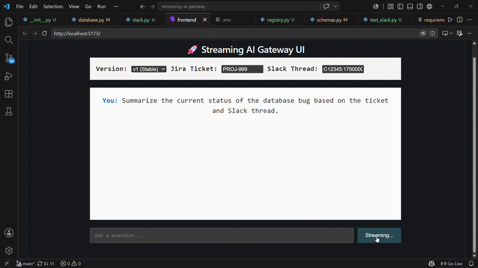
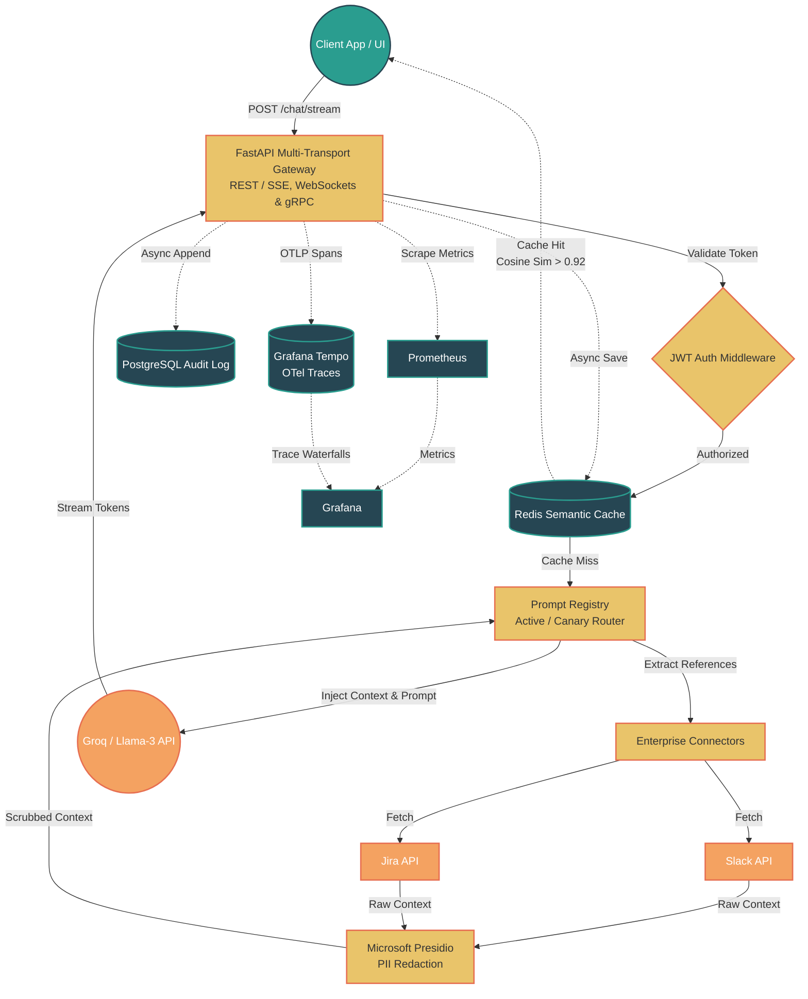
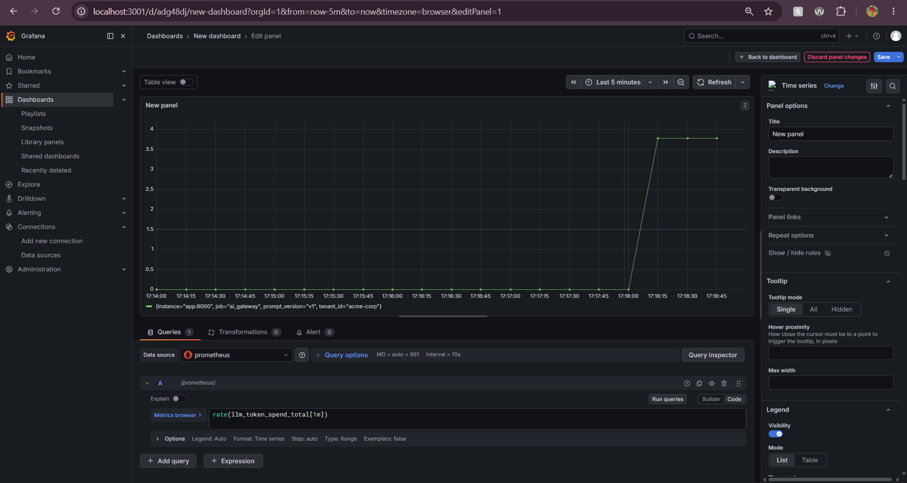

# 🚀 Streaming AI Gateway


An enterprise-grade, multi-transport (REST/SSE, WebSockets & gRPC) AI Gateway engineered for low-latency LLM streaming, real-time context injection, strict PII privacy, and CI-gated prompt deployments.

## ✨ The "Wow" Factor: Dynamic Context Injection

_Below is a demonstration of the gateway streaming tokens in real-time while dynamically intercepting a Slack/Jira reference, securely fetching the context, and injecting it into the LLM prompt._



---

## 🏗️ Architecture



---

## ⚡ Quickstart (Run in < 2 Minutes)

```bash
git clone [https://github.com/sahej009/streaming-ai-gateway.git](https://github.com/sahej009/streaming-ai-gateway.git)
cd streaming-ai-gateway
echo "GROQ_API_KEY=your_key_here" > .env
docker compose up -d --build
```

**Access the Application:**

- **Chat UI:** http://localhost:3000
- **API Docs (Swagger):** http://localhost:8000/docs
- **Prometheus Metrics:** http://localhost:8000/metrics
- **Grafana Dashboards (Metrics + Tempo Traces):** http://localhost:3001

---

## 🛠️ Core Enterprise Features

- **Multi-Transport Streaming:** Streams tokens directly from the LLM to clients via Server-Sent Events (SSE), WebSockets, and gRPC.
- **Semantic Caching & Eager Warmup:** Uses pre-warmed HuggingFace embeddings (`all-MiniLM-L6-v2`) and Redis to return semantically similar queries without hitting the upstream LLM, cutting median cached latency from `835 ms` to `64 ms`.
- **Dynamic Prompt Routing & Automated Canary Rollbacks:** Routes traffic across YAML-defined prompt versions (`v1` / `v2`) via Redis weights. A background watchdog (`app/services/watchdog.py`) and CI deployment pipeline (`.github/workflows/deploy.yml`) monitor Prometheus `5xx` rates and `hallucination_score` gauges, automatically promoting healthy canaries or rolling back degraded releases.
- **50-Case LLM-as-a-Judge CI Quality Gate:** Every pull request touching `prompts/` or `app/` boots the containerized gateway in GitHub Actions (`.github/workflows/eval.yml`), runs a 50-case evaluation suite (`evals/run_judge.py`), and blocks merges if faithfulness drops below threshold.
- **Enterprise Context Connectors & PII Redaction:** Intercepts Jira ticket IDs and Slack threads asynchronously, scrubs PII (emails, phone numbers, names) through Microsoft Presidio, and injects clean context before calling the LLM.
- **Append-Only Audit Logging:** Persists every interaction, token count, and latency record to PostgreSQL asynchronously off the streaming hot-path.
- **End-to-End Observability (Prometheus + OpenTelemetry + Tempo):** Combines Prometheus counters/gauges (`llm_token_spend_total`, `cache_hits_total`, `gateway_llm_cost_usd`, `hallucination_score`) with OpenTelemetry distributed tracing exported to Grafana Tempo, capturing per-request TTFT (`llm.ttft_ms`), token throughput, and embedding latencies.

---

## 🧪 Evaluation Gate & Latency Optimization (Before vs. After)

Distributed tracing in Grafana Tempo exposed a **~1.4s cold-start stall** caused by lazy-loading `all-MiniLM-L6-v2` on the first request. Moving embedding initialization into FastAPI's eager startup lifecycle and validating across the 50-case evaluation suite (`evals/test_set.json`) delivered the following gains:

| Metric (50-Case Eval Suite)     | Before Optimization         | After Optimization      | Engineering Impact                                           |
| :------------------------------ | :-------------------------- | :---------------------- | :----------------------------------------------------------- |
| **Average End-to-End Latency**  | `2.55 s`                    | **`0.58 s`**            | **77% faster** via eager embedding warmup & semantic caching |
| **Tail Latency (p95)**          | Cold-start spike (`>2.5 s`) | **`1.24 s`**            | Eliminated first-request model loading stall                 |
| **Semantic Cache Hit Rate**     | `0%` (cold)                 | **`31%`**               | Offloaded repeated/paraphrased queries to Redis              |
| **LLM-as-a-Judge Faithfulness** | Baseline unverified         | **`0.94`**              | Enforced automatically on every PR via `eval.yml`            |
| **Estimated Token Spend Delta** | Baseline                    | **`-$0.0076 / 1k req`** | Direct API cost savings from cache hits                      |

---

## 📊 Load-Testing & Concurrency Benchmarks

Stress-tested under 50-user concurrency using Locust (`tests/locustfile.py`):

| Metric                   | Baseline (Cached Routing) | 50-User Stress Test           | Engineering Impact                                  |
| :----------------------- | :------------------------ | :---------------------------- | :-------------------------------------------------- |
| **Median Latency (p50)** | **64 ms** (18 ms min)     | **630 ms**                    | **~92% latency reduction** via Redis semantic cache |
| **Tail Latency (p95)**   | **94 ms**                 | **1,300 ms**                  | Sub-100ms p95 routing for cached queries            |
| **Throughput**           | 4.4 RPS                   | **18.9 RPS** (~1,130 req/min) | Sustained high-concurrency SSE streaming            |
| **Streamed Requests**    | 595                       | **1,809**                     | **0% Failure Rate** (`0` dropped streams)           |


